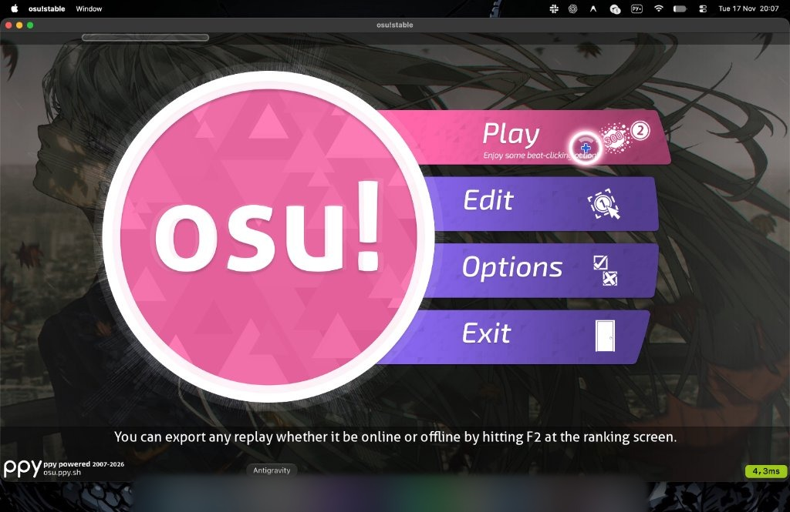
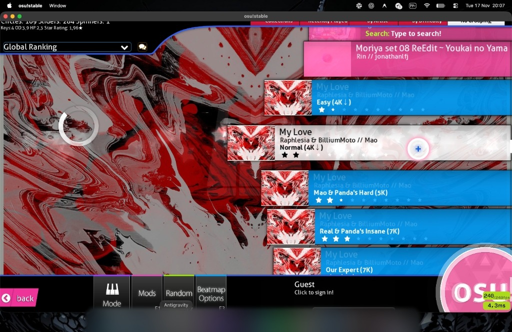
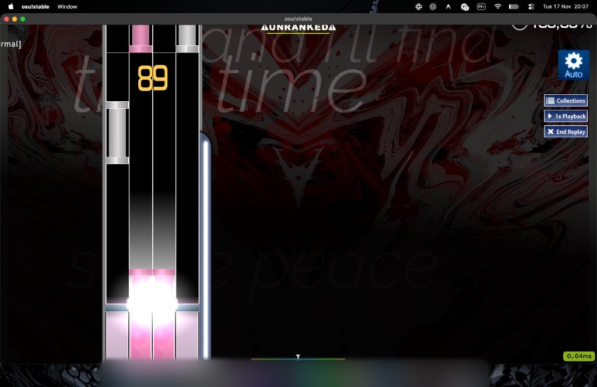

# osu!stable for macOS (Apple Silicon Native)

[-brightgreen.svg?style=flat-square)](https://github.com/osustabmac/unofficial_osustable_mac)
[](https://dotnet.microsoft.com/)
[](https://libsdl.org/)
[](https://github.com/osustabmac/unofficial_osustable_mac/releases)
[-success.svg?style=flat-square)](https://github.com/osustabmac/unofficial_osustable_mac)
[](https://osustabmac.pages.dev)

A native, high-performance compatibility runtime and port for the classic rhythm game client engineered for **Apple Silicon (M1/M2/M3/M4) macOS**.

Built completely free of Wine, CrossOver, or Rosetta 2 translation layers, running as a pure 64-bit ARM64 application on modern **.NET 10**.

---

> ### ⚠️ Current Status: OFFLINE MODE ONLY
> This native compatibility port currently operates **strictly in offline mode**.
> - ✅ Full local gameplay, beatmap importing, and skin loading.
> - ✅ Precise local hit evaluation, audio sync, and offline replays.
> - ❌ **No connection to official online services (Bancho) at the moment**. Online rankings, multiplayer lobbies, and account logins are currently disabled / not connected.

---

## 📸 In-Game Screenshots

<p align="center">
  <a href="docs/screenshots/screenshot-menu.jpg"></a>
  <a href="docs/screenshots/screenshot-songselect.jpg"></a>
  <a href="docs/screenshots/screenshot-gameplay.jpg"></a>
</p>
<p align="center">
  <em>Tested Benchmark: <strong>0.50–0.60 ms frametimes on MacBook Air M2</strong> • Native Apple Silicon rendering with crisp Retina UI (click to enlarge)</em>
</p>

---

## ⚡ Key Highlights & Architecture

* **Zero Emulation Overhead**: Runs native ARM64 instructions directly on Apple Silicon cores.
* **ProMotion & Retina Display Optimization**: Ultra-low latency rendering pipeline using native SDL3 and Metal windowing, achieving **0.50–0.60 ms frametimes on MacBook Air M2**, supporting 120Hz/240Hz refresh rates with uncapped framerates.
* **Direct 64-bit Audio Synchronization**: Sub-millisecond audio clock precision powered by direct 64-bit BASS ARM64 native bindings — eliminating the audio drift notorious in Wine wrappers.
* **Self-Contained Typography Pipeline**: Embedded Pango, Cairo, and Fontconfig runtime ensuring crisp font rasterization across all resolutions out of the box.

---

## 📦 Download & Installation

Download the ready-to-run macOS Apple Silicon package:  
👉 **[Download osu!stable-macOS-arm64.dmg (v1.0.0)](https://github.com/osustabmac/unofficial_osustable_mac/releases/download/v1.0.0/osu.stable-macOS-arm64.dmg)** (378 MB)

### Installation Steps
1. Open `osu!stable-macOS-arm64.dmg`.
2. Drag **osu!stable.app** into your **Applications** folder.
3. Launch **osu!stable** from Launchpad or Applications!

### 💡 First Run: macOS Gatekeeper Authorization
Because this is an independent community build without an Apple Developer ID notarization certificate, macOS Quarantine may flag the app on first launch (*"App is damaged and can't be opened"*).

You can authorize it in one of two ways:
* **Via DMG (Easiest)**: Double-click the included **Activate & Launch.command** inside the DMG.
* **Via Terminal**: If you already moved the app to `/Applications`, run:
  ```bash
  xattr -cr /Applications/osu!stable.app
  ```

---

## 📂 Source Code Structure

> **💡 100% Original Author-Written Code**:  
> Every file and line of code in this repository is **100% original, clean-room authored code** developed from scratch. It does **NOT** contain, copy, or redistribute any stolen, proprietary, or decompiled code from the original osu!stable client. It was created exclusively as an independent platform bridge and runtime compatibility layer to enable the game to run correctly, natively, and flawlessly on **macOS and Apple Silicon (ARM64)**.

The repository is structured as follows:

| Directory | Description |
| :--- | :--- |
| **[`src/MacFormsCompatibility`](src/MacFormsCompatibility/)** | Clean-room implementation of `System.Windows.Forms` for .NET 10 ARM64, replacing legacy Win32 User32/GDI+ dependencies with an abstracted platform surface. |
| **[`src/MacPlatformBridge`](src/MacPlatformBridge/)** | Native macOS integration layer: Cocoa activation (`NSApplication`), SDL3 window host, Retina coordinate scaling, Pango/Cairo font engine, and sandboxed platform services. |
| **[`src/OsuStable.Core`](src/OsuStable.Core/)** | Clean-room engine core: high-performance `.osu` beatmap parser, timing point math, hitobject mechanics, and scoring algorithms. |
| **[`src/OsuStable.Native`](src/OsuStable.Native/)** | Hardware-accelerated audio engine (BASS ARM64), platform input capture, and render loop orchestration. |
| **[`tests/OsuStable.Core.Tests`](tests/OsuStable.Core.Tests/)** | Automated unit tests covering parser accuracy, slider curve math, and timing evaluation. |

---

## 🛠️ Building the Clean Core & Tests

Requirements:
- macOS 12+ (Apple Silicon recommended)
- [.NET 10 SDK](https://dotnet.microsoft.com/)

Run the core unit tests:
```bash
dotnet test tests/OsuStable.Core.Tests
```

Run the native prototype:
```bash
dotnet run --project src/OsuStable.Native
```

---

## ⚖️ Legal Disclaimer & Clean-Room Notice

This is an **independent, non-commercial open-source compatibility and educational project**:

- **100% Original Code**: All code published in this repository is original, author-written software developed independently to solve platform interoperability on modern macOS ARM64 systems. Zero code was extracted, decompiled, or stolen from official proprietary repositories.
- **No Proprietary Assets**: This repository does **NOT** contain, redistribute, or host copyrighted game assets, beatmaps, or proprietary binaries.
- **Trademarks & Attribution**: All game trademarks, branding, audio assets, and original game design belong to **ppy Pty Ltd** and their respective copyright holders. This project is not affiliated with, endorsed by, or approved by Dean Herbert (peppy) or ppy Pty Ltd.
